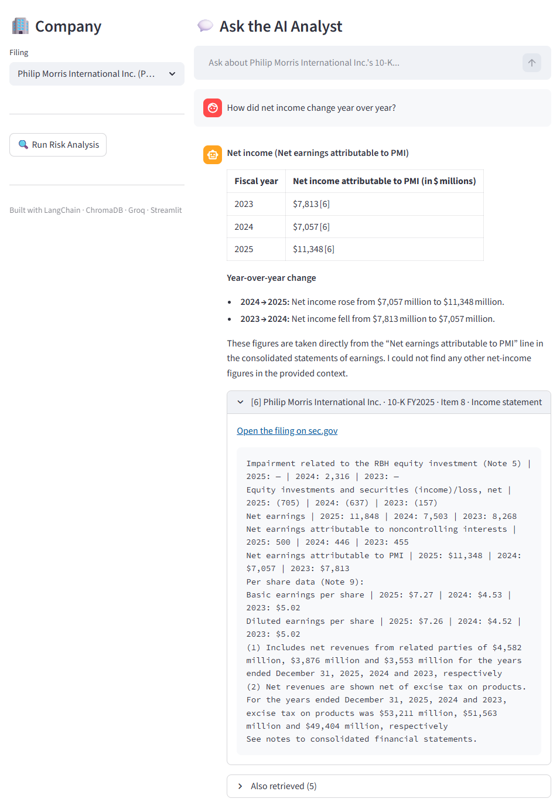
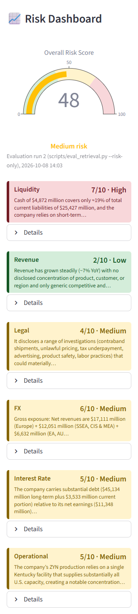

# FinSight

Ask questions about SEC 10-K filings and get answers with their sources, plus
six risk scores per company, each with a reason that cites the filing.




## What it does

FinSight works on four FY2025 10-K filings from SEC EDGAR: Apple, Tesla,
Coca-Cola and Philip Morris International. In a Streamlit app you pick a
filing and can:

- **Ask questions.** Answers cite numbered passages; each one opens in the
  app with a link to the filing on sec.gov.
- **Run a risk analysis.** Liquidity, revenue, legal, FX, interest rate and
  operational risk are scored 1-10 against a written rubric, with an
  overall 0-100 score.

  

## How it works

- **Fetch:** downloads the pinned 10-K filings from SEC EDGAR.
- **Parse:** splits each filing into its Items and turns tables into labelled
  rows (`Total revenues | 2025: 94,827 | 2024: 97,690`).
- **Index:** chunks with all-MiniLM-L6-v2 embeddings in ChromaDB, tagged by
  filing, Item and financial statement.
- **Retrieve:** fixed quotas per Item, so the right sections reach the model;
  every risk prompt includes the company's revenue and earnings for scale.
- **Answer:** `openai/gpt-oss-120b` on Groq cites the passages it uses; a
  warn-only check flags figures not found in the cited passages.

## Key results

- **Retrieval:** 10 of 10 hit checks find the expected filing passage.
- **Q&A:** 8 of 8 revenue and net-income answers match the filings.
- **Risk scores:** 6 of 8 FX and interest-rate scores within ±1 of reference
  scores; one retrieval fix cut the largest miss from 6 points to 2.

Single runs at temperature 0.1. Method, rubric and full results:
[docs/EVALUATION.md](docs/EVALUATION.md).

## Limitations

- Only SEC 10-K filers (US-listed companies), four companies, one fiscal year.
- Reference scores exist for 2 of the 6 risk categories, and scores can vary
  between runs.
- The model's own arithmetic in risk reasons is not verified, and tables can
  be misread.
- The free Groq tier has a daily token limit.

## Setup

Requires Python 3.11 and a free Groq API key (https://console.groq.com).

```bash
git clone https://github.com/Yigituysgl/Finsight.git
cd Finsight
python -m venv .venv
```

Activate the environment (`.venv\Scripts\activate` on Windows,
`source .venv/bin/activate` on macOS/Linux), then:

```bash
pip install -r requirements-dev.txt
```

On Windows, clone into a short path: onnxruntime (a Chroma dependency)
exceeds the 260-character path limit under long folder names.

Copy `.env.example` to `.env` and set `GROQ_API_KEY`, `GROQ_MODEL`
(`openai/gpt-oss-120b`) and `SEC_USER_AGENT` (a name and contact email, which
EDGAR requires); `LLM_TEMPERATURE` is optional (default 0.1). Then:

```bash
python src/fetch_filings.py
python src/ingest.py
streamlit run src/app.py
```

Tests need no API key or network: `pytest`.

## Author

**Yigit Uysaloglu** · [LinkedIn](https://www.linkedin.com/in/yigit-uysaloglu/) · [GitHub](https://github.com/Yigituysgl)

## License

MIT, see [LICENSE](LICENSE).
